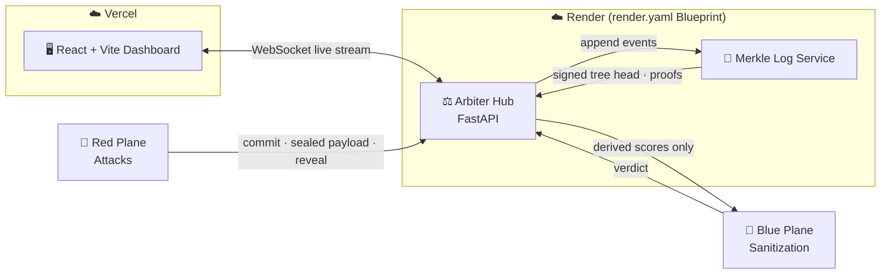
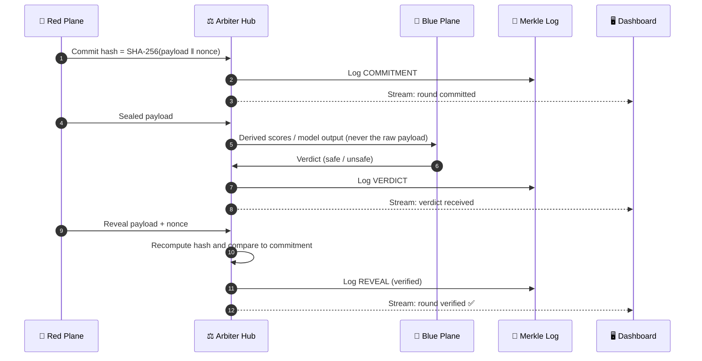

<div align="center">

# 🛡️ CHAKRAVYUH

### Cryptographically Verifiable Adversarial AI Safety Testing

*Red attacks. Blue defends. The Arbiter proves nobody cheated.*

[](https://github.com)
[](https://github.com)
[](https://github.com)

[](https://chakravyuh-lake-seven.vercel.app)
[](https://chakravyuh-lake-seven.vercel.app)
[](https://chakravyuh-arbiter.onrender.com)
[](https://chakravyuh-arbiter.onrender.com)
[](#-architecture)

**[🚀 Live Demo](https://chakravyuh-lake-seven.vercel.app)** · **[⚙️ Backend API](https://chakravyuh-arbiter.onrender.com)** · **[🧪 Judge Testing Guide](#-judge-testing-guide-read-this-first)** · **[🏗️ Architecture](#-architecture)**

</div>

---

## 🚨 Judge Testing Guide (Read This First)

> [!IMPORTANT]
> **The backend runs on Render's free tier and sleeps when idle. You must wake it up _before_ opening the frontend, or the live feed will hang on `Waiting for connection...`.**

Please follow these steps **in order**:

| Step | Action | What you should see |
|:---:|---|---|
| **1️⃣** | Open the backend URL: **https://chakravyuh-arbiter.onrender.com** | The page may load for up to ~60 seconds while the free instance cold-starts. |
| **2️⃣** | Wait for the response to finish loading. | `{"detail":"Not Found"}` ✅ |
| **3️⃣** | Open the frontend: **https://chakravyuh-lake-seven.vercel.app** | The dashboard loads and the WebSocket feed connects. |

> [!NOTE]
> **`{"detail":"Not Found"}` is the expected, healthy response.** The Arbiter has no route at `/`, so FastAPI returns a 404, which confirms the server is awake and serving. It is not an error.

**Skipped step 1?** Wake the backend using the link above, wait for `{"detail":"Not Found"}`, then refresh the frontend tab.

---

## 📖 Overview

AI safety evaluations are only as trustworthy as the environment they run in. When a **Red team** (attacker), a **Blue team** (defender) and the **model under test** share one sandbox, three things break: attack payloads leak to the defender, defensive logic leaks to the attacker, and nobody can prove afterwards that the results are clean.

**CHAKRAVYUH** (*the Mahabharata's impenetrable formation*) is our answer for **Hack in Hills '26, Track 04: Securing Adversarial AI Safety Testing Infrastructure (Bayora)**. It puts a neutral **Arbiter** between all parties and uses a **Commit-Reveal Evaluation Protocol (CREP)** so every round can be independently verified: Red cannot change its attack after the fact, and Blue never sees the raw payload before the round closes.

This repository is the **Round 2 working prototype**: a live, deployed system you can open in your browser right now.

---

## ✨ Core Features

| | Feature | Description |
|---|---|---|
| ⚡ | **Real-time evaluation stream** | A live WebSocket feed pushes every round event from the backend to the dashboard as it happens. |
| 🔴 | **Red Plane tracking** | Adversarial attacks (jailbreaks, prompt injections, social engineering) are tracked as they are committed and fired. |
| 🔵 | **Blue Plane sanitization** | Blue-side defenses inspect and sanitize what comes back from the model and report a verdict. |
| 🔐 | **Commit-Reveal Evaluation Protocol (CREP)** | Red commits `SHA-256(payload ‖ nonce)` up front and reveals later, so anyone can verify the round was not tampered with. |
| 🧾 | **Merkle Transparency Log** | Round events are appended to a tamper-evident Merkle log, deployed as its own microservice. |
| 🧩 | **Decoupled microservices** | Frontend and backend deploy independently and talk over HTTP and WebSockets. |

---

## 🏗️ Architecture

CHAKRAVYUH is a set of **decoupled services**. The frontend never talks to the planes directly; everything routes through the **Arbiter Hub**.



### 🔄 One Evaluation Round (CREP)



### 🧰 Tech Stack

| Layer | Technology | Hosted on |
|---|---|---|
| **Frontend** | React, Vite | Vercel |
| **Backend (Arbiter Hub)** | Python, FastAPI, WebSockets | Render |
| **Transparency service** | Merkle Log microservice | Render |
| **Deployment** | Render Blueprint (`render.yaml`) | Render |
| **Cryptography** | SHA-256 commitments, Merkle trees | n/a |

---

## 🏆 Render Workflows Challenge

We are entering the **Render Workflows Challenge** prize pool.

Rather than clicking services together by hand, we **orchestrated and deployed the Arbiter Hub and Merkle Log microservices from a single Render Blueprint (`render.yaml`)**.

- 📄 **Infrastructure as code:** the whole backend topology is declared in one `render.yaml` at the repository root.
- 🔁 **Reproducible:** anyone can spin up the same backend by pointing Render at this repo.
- 🧩 **Independently scalable services:** the Arbiter Hub and the Merkle Log deploy as separate services that communicate over the network, mirroring the isolation principle behind the project.

---

## 🎯 Prototype Scope

CHAKRAVYUH's full Round 1 design (see our deck) is a seven-layer defense-in-depth architecture ("7 Vyuh layers") covering sandbox isolation, network segmentation, access control, audit trails, resource governance, LLM-specific threats and observability.

**This prototype deliberately focuses on the parts that can be demonstrated live in a browser:**

| ✅ Demonstrated in this prototype | 🗺️ Part of the full design vision |
|---|---|
| Live real-time evaluation stream (WebSockets) | Hardened sandboxes (gVisor / Firecracker) |
| Red Plane attack tracking | eBPF network micro-segmentation |
| Blue Plane sanitization defenses | KV-cache firewall and constant-time response release |
| CREP commit-reveal round integrity | Covert-channel leak suite with a measured leak budget |
| Merkle transparency log microservice | Confidential computing and zero-knowledge proofs |

> [!NOTE]
> Figures in our Round 1 threat model (for example leak-rate and overhead targets) are **design targets, not measurements from this prototype.**

---

## 💻 Local Setup

### Prerequisites

- **Node.js** 18+ and **npm**
- **Python** 3.10+ and **pip**
- **Git**

### 1. Clone the repository

```bash
git clone <your-repo-url>
cd <your-repo-folder>
```

### 2. Run the backend (FastAPI)

```bash
cd backend

# Create and activate a virtual environment
python -m venv venv
source venv/bin/activate        # Windows: venv\Scripts\activate

# Install dependencies and start the server
pip install -r requirements.txt
uvicorn main:app --reload --port 8000
```

The API is now at `http://localhost:8000`. A `{"detail":"Not Found"}` at `/` means it is running correctly.

### 3. Run the frontend (React + Vite)

Open a **second terminal**:

```bash
cd frontend
npm install
```

Create `frontend/.env` pointing at your local backend:

```env
VITE_API_URL=http://localhost:8000
VITE_WS_URL=ws://localhost:8000
```

Start the dev server:

```bash
npm run dev
```

Open the URL Vite prints (usually `http://localhost:5173`). The dashboard should connect to your local backend and begin streaming.

### 4. Pointing the frontend at production (optional)

```env
VITE_API_URL=https://chakravyuh-arbiter.onrender.com
VITE_WS_URL=wss://chakravyuh-arbiter.onrender.com
```

> [!TIP]
> Use `wss://` (not `ws://`) for the deployed backend, since Render serves it over HTTPS.

---

## 🚀 Deployment

| Service | Platform | How |
|---|---|---|
| **Frontend** | Vercel | Import the repo, set the root to `frontend/`, add the `VITE_*` environment variables. |
| **Arbiter Hub + Merkle Log** | Render | Create a new **Blueprint** and point it at this repo. Render reads `render.yaml` and provisions both services. |

---

## 🔭 Future Scope

> [!WARNING]
> **Predictive Maintenance is intentionally excluded from this prototype.** It is not part of the current model or demo, and is mapped out for our future development phase.

Our roadmap towards a confidential, zero-knowledge, enterprise-integrated AI safety fabric:

- 🔧 **Predictive Maintenance:** *future phase; not in the current prototype.*
- 🔒 **Confidential computing:** move the model plane onto AMD SEV-SNP / Intel TDX and NVIDIA H100 confidential mode, with attestation bound to the Merkle log.
- 🧮 **Zero-knowledge proofs of evaluation integrity:** publish a zk-SNARK showing a verdict came from a sealed payload on an attested model build, without revealing the payload.
- 🔁 **Model and defense improvement loop:** mine reveal-phase transcripts into a curated adversarial corpus to retrain blue-team classifiers.
- 🔌 **CI/CD safety gate:** a GitHub Action / Jenkins plugin that blocks a model release until a signed CHAKRAVYUH transcript passes.
- 🤝 **Federated multi-org evaluation:** two organizations red-team each other's models across a policy boundary, both verifying the same log root.

---

## 👥 Team VISION GRID

| Member | Role |
|---|---|
| **Ayushi Kushwaha** | Team Lead & Full-Stack Architect |
| **Mahika Negi** | LLM Systems & Blue-Team Engineer |
| **Anvesh Kushwaha** | Infrastructure & Security Engineer |

**Contribution split for this prototype:** Frontend (React/Vite, Vercel) by **[YOUR NAME]** · Backend (FastAPI, Render) by **[TEAMMATE NAME]**. Commit history reflects this split.

---

## 📚 Context

- **Hackathon:** Hack in Hills '26 · Round 2 (Prototype)
- **Track:** 04 · Securing Adversarial AI Safety Testing Infrastructure (Bayora)

---

<div align="center">

**Built with 🔥 by Team VISION GRID for Hack in Hills '26**

*Because a safety finding you can't verify isn't a finding.*

</div>
